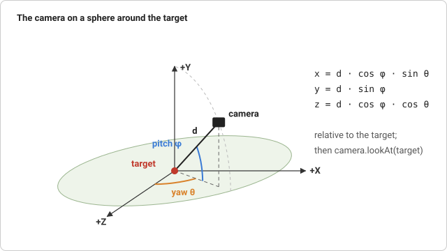

# Orbit controls

Orbit controls are the standard way to look at a 3D scene with a mouse or a
finger. You turn around a point of interest, move that point, and come closer
or back off. The camera never loses sight of the point. Model viewers use
them, and so do strategy and city-building games, where the point of
interest slides over a map. This page covers the ideas behind them: a
coordinate system that fits the gestures, pointer events, the pinch gesture,
keyboard movement, and easing that feels the same at any frame rate.

## Spherical coordinates

A camera that orbits a point stays on a sphere around it. Describing its
position as `(x, y, z)` makes every gesture awkward: "turn left a bit" changes
`x` and `z` together, in a way that depends on where the camera already is.
On the sphere, three numbers describe the camera position, and each gesture
changes exactly one of them:

- **distance** `d`: the sphere's radius, changed by zooming
- **yaw** `θ`: the angle around the vertical axis, changed by dragging sideways
- **pitch** `φ`: the elevation above the target's horizon, changed by
  dragging up and down



Converting back to a position is two steps of trigonometry. Pitch splits the
distance into a height `d·sin φ` and a horizontal part `d·cos φ`. Yaw then
splits the horizontal part between X and Z:

```
x = target.x + d · cos φ · sin θ
y = target.y + d · sin φ
z = target.z + d · cos φ · cos θ
```

With `θ = φ = 0` the camera sits on the +Z axis looking down -Z, which is
the default view of a magic-pixels camera. Limits also become simple: "never
go below the ground" is `φ ≥ 0`, and "not too far away" is `d ≤ max`.

Physics and many maths texts measure the polar angle from the north pole
instead of from the horizon. That is the same system with `90° − φ` in place
of `φ`. Elevation from the horizon is more natural for a camera, because
pitch 0 means looking straight ahead.

## Looking at the target

Once the camera is placed, `camera.lookAt(target)` turns it to face the
target (see [Cameras](../core/cameras.md)). A look-at matrix builds the
camera's axes from two cross products: _right_ from _forward_ and _up_, then
the camera's own _up_ from _right_ and _forward_. When the camera looks
straight down, _forward_ and the world's up axis are parallel, their cross
product is the zero vector, and the camera's sideways direction is undefined.
The view flips or spins at that point. So pitch stops a thousandth of a
radian short of ±90°: close enough that nobody notices, far enough for the
cross product to stay well defined.

## Pointer events

Browsers report mouse, pen and touch input through one family of events:
`pointerdown`, `pointermove`, `pointerup` and `pointercancel`. Every event
carries a `pointerId`, and each finger on a touch screen gets its own. A few
details decide whether controls feel right:

- **Pointer capture.** `element.setPointerCapture(id)` sends every later
  event of that pointer to the element, even after it leaves the element or
  the window. Without it, a drag that leaves the canvas ends without a
  `pointerup` event and is stuck.
- **`touch-action: none`.** By default the browser treats a finger drag as a
  scroll or a page zoom and cancels the pointer events. This CSS property
  tells it that the element handles touch itself.
- **`buttons`** is a bit mask: 1 is the primary button, 2 the secondary, 4
  the middle. Right-drag pans, so the `contextmenu` event is cancelled to
  stop the menu from popping up.
- **`wheel`** events report `deltaY` in pixels or, with `deltaMode` 1, in
  lines. Cancelling them needs a listener registered with
  `{ passive: false }`, otherwise the page scrolls anyway.

## Pinching

Two fingers do two things at once. Spreading them apart zooms, and moving
them together pans. Both come from the same two numbers: the distance
between the fingers (the _spread_) and the point halfway between them.

Every time a finger moves, the controls compute both numbers before and
after the move. The ratio of the spreads scales the distance:

```
distance ← distance × spreadBefore / spreadAfter
```

Fingers twice as far apart halve the distance, and the scene looks twice as
big, which is what the fingers expect. A multiplication also behaves the
same near and far: one pinch always zooms by the same factor. A subtraction
would crawl when the camera is far away and overshoot through the target
when it is close. The wheel works the same way, as `distance × e^(k·deltaY)`,
so equal wheel steps give equal factors. A trackpad pinch reaches the page
as a wheel event with `ctrlKey` set.

The midpoint's movement pans. The direction of the line between the
fingers, `atan2(dy, dx)`, turns: if the line rotates by an angle, the yaw
changes by that angle, so the map turns with the fingers like a sheet of
paper. Angles wrap around at ±180°. A step from 179° to −179° is 2°, not
−358°, so the difference is brought back into (−180°, 180°] before it is
used. When one finger lifts, the other carries on turning, and because each
pointer remembers its own last position, the camera does not jump.

## Panning by the right amount

When the user drags the scene, the point under the pointer should follow
the pointer. That needs a conversion from pixels to world units. A
perspective camera with vertical field of view `fov` sees a slice of height
`2 · d · tan(fov / 2)` at distance `d`. Divide by the element's height in
pixels and you get the world size of one pixel at the target:

```
worldPerPixel = 2 · d · tan(fov / 2) / heightInPixels
```

The target then moves by `dx · worldPerPixel` along the camera's right axis.
For the vertical part there are two choices. One moves the target along the
camera's up axis, which keeps whatever is under the pointer there from any
angle. The other moves it along the camera's forward direction flattened
onto the ground, which feels like sliding a map over a table and never
lifts the target off the ground.

## Keys that hold

Pointer events report movement, and the controls turn each one into a
change of the goal. A key is different: `keydown` only says that a key went
down. Its auto-repeat is too slow and uneven to drive movement. So the
controls keep a set of the keys that are down, and `update(dt)` moves the
target by `speed × dt` for each frame they stay down. That is the usual
pattern for game input: events record state, and the frame loop acts on it.

A few details again:

- Keys are matched by `event.code`, the key's place on the keyboard
  (`KeyW`), not by `event.key`, the character it types. WASD then stays a
  cross on a French AZERTY keyboard, where those keys read ZQSD.
- Key events go to the focused element. A canvas only gets the focus once it
  has been clicked, so the controls listen on the window, and they ignore
  keys typed into a text field.
- If the window loses the focus while a key is down, its `keyup` goes
  elsewhere and the camera would drift forever. On `blur` the set is cleared.
- The speed is in distances per second: zoomed out, the camera moves
  faster, so a key press crosses the screen in the same time at any zoom.

## Easing that ignores the frame rate

Moving the camera straight to where the input says feels mechanical. Smooth
controls keep a _goal_ and move the _current_ value part of the way there
every frame. The obvious version, `current += (goal - current) × 0.1`, has a
catch: at 120 frames per second it moves twice as often as at 60 and feels
twice as fast.

The fix is to ask what fraction of the gap should remain after `dt` seconds.
For smooth, exponential decay with a rate `λ`, the remaining fraction is
`e^(−λ·dt)`, so the step is:

```
k = 1 − e^(−λ·dt)
current += (goal − current) × k
```

Two half frames leave `e^(−λ·dt/2) · e^(−λ·dt/2) = e^(−λ·dt)`, exactly what
one full frame leaves. However the time is cut into frames, the camera ends
up in the same place. With `λ = 10`, about 63% of the gap closes in 0.1
seconds. `λ = ∞` makes `k = 1` and moves the camera straight to the goal.

## In magic-pixels

{@link OrbitControls} is imported from its own entry point:

```js
import { OrbitControls } from 'magic-pixels/controls';

const controls = new OrbitControls(camera, canvas, { minDistance: 2 });
// each frame:
controls.update(dt);
renderer.render(scene, camera);
```

Two design decisions are worth knowing:

- **A separate entry point.** The core library is plain data plus a
  renderer and has no DOM input code. The controls live in
  `magic-pixels/controls`. Their bundle imports the core by the package's
  name instead of carrying a copy, so the `Vector` it creates is the same
  class the camera uses.
- **Opt-in keyboard, an off switch.** `keyboard: true` adds the window
  listeners. Without it the controls never touch the keyboard, which
  belongs to the page. `enabled = false` ignores all input, for example
  while a game shows a menu or the player drags a unit.
- **Limits on the goal.** `minDistance`/`maxDistance`, `minPitch`/`maxPitch`
  and `targetBounds` (a {@link Box3} for the target) clamp the goal on
  every `update()`, so they can change at any time. They limit the target,
  not the camera: at the edge of the box, the camera can still be up to
  `maxDistance` beyond it.
- **Goal and current, no rig.** Input only writes to `controls.goal`
  (`target`, `distance`, `yaw`, `pitch`). `update(dt)` eases
  `controls.current` towards it, then sets `camera.position` and calls
  `lookAt`. The camera stays an ordinary object: in the scene or not, and
  with any parent (the position is in the parent's space). A camera placed
  before the controls are created keeps its place, because the starting
  angles are worked out from where it is. Set a goal and call `snap()` to
  jump there without easing.

The files:

- `src/controls/orbit-controls.ts`: the {@link OrbitControls} class, with the
  pointer, wheel and key handling, the pinch and twist, the pan and the
  easing.
- `src/controls/index.ts`: the `magic-pixels/controls` entry point.
- `build.js`: bundles the entry point to `dist/controls.js` and leaves the
  core import to the package name.

## Try it

Open the
[toy city](https://learosema.github.io/magic-pixels/examples/14-toy-city/)
on a phone. One finger turns, and two fingers pinch, pan and twist. On a
computer, walk around with WASD and turn with Q and E. Either way the target
cannot leave the island (`targetBounds`). The
[glTF loader](https://learosema.github.io/magic-pixels/examples/10-gltf-loader/)
uses screen-space panning instead. Right-drag the helmet and it stays under
the pointer from any angle. Then experiment:

- Set `damping: Infinity` and feel the difference easing makes.
- Add a key of your own: R and F changing `controls.goal.pitch` to tilt the
  view. The easing comes for free.
- Make a double-click fly to a new target: set `controls.goal.target` and
  let `update()` glide there.

## Further reading

- [MDN: Pointer events](https://developer.mozilla.org/en-US/docs/Web/API/Pointer_events):
  the event model, `pointerId`, `buttons` and pointer capture.
- [MDN: Pinch zoom gestures](https://developer.mozilla.org/en-US/docs/Web/API/Pointer_events/Pinch_zoom_gestures):
  tracking two pointers to detect a pinch, the same approach as above.
- [MDN: touch-action](https://developer.mozilla.org/en-US/docs/Web/CSS/touch-action):
  what the browser does with a touch unless told otherwise.
- [3D Math Primer, chapter 7: Polar coordinate systems](https://gamemath.com/book/polarspace.html):
  spherical coordinates, their conventions, and the singularity at the
  poles.
- [MDN: KeyboardEvent.code](https://developer.mozilla.org/en-US/docs/Web/API/KeyboardEvent/code):
  physical key codes versus the typed `key`.
- [Learn OpenGL: Camera](https://learnopengl.com/Getting-started/Camera):
  yaw and pitch from mouse movement, and the look-at matrix.
- [Rory Driscoll: Frame rate independent damping using lerp](https://www.rorydriscoll.com/2016/03/07/frame-rate-independent-damping-using-lerp/):
  the `1 − e^(−λ·dt)` derivation.
